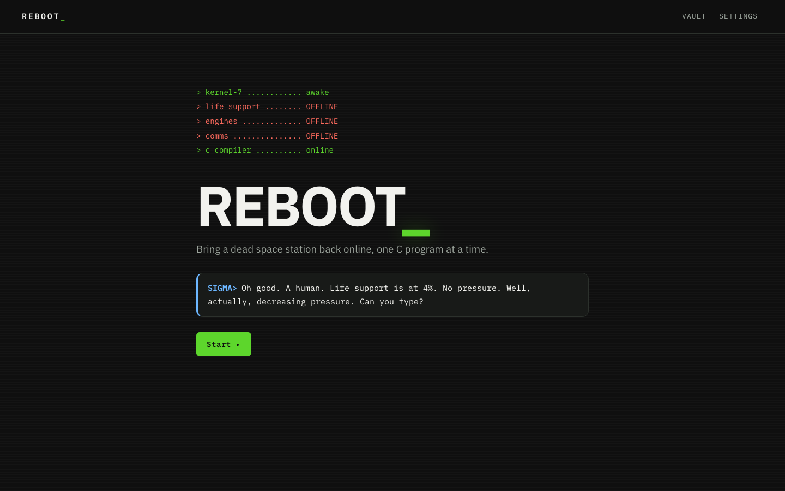

# REBOOT

> Learn C by bringing a dead space station back online, one program at a time.

**[▶ Play it in your browser](https://byteforge1729.github.io/reboot-c/)** · no install, no account



## Overview

REBOOT is a story-driven C course. You wake up on a dark space station whose only working
terminal understands C, and SIGMA, the station's sarcastic AI, talks you through repairing it.
Each station system is a mission that teaches one C topic; you restore the system by writing
real C that is compiled and graded in the browser.

## Missions

| # | System | Topic |
|---|---|---|
| 0 | Boot Sequence | Your first C program |
| 1 | Life Support | C programming basics |
| 2 | Power Grid | Operators |
| 3 | Airlock Security | Conditional statements |
| 4 | Engines | Loops |
| 5 | Repair Drones | Functions |
| 6 | Cargo & Comms | Arrays and strings |
| 7 | Core Rewiring | Pointers and structures |
| 8 | Reactor Leak | Memory management |
| 9 | Black Box | File and error handling |
| 10 | Universal Translator | Variadic functions |
| 11 | Alarm System | Signals |
| 12 | Distress Beacon | Socket programming |
| 13 | Drone Swarm | Multithreading |

## Key Features

- **Lessons → warm-ups → boss problems** for each mission: 14 lessons and 40 judged problems.
- **Warm-up drills** in several formats: predict the output, fill in the blank, Parsons (reorder lines), and short judged snippets.
- **Real compilation and grading:** code runs on GCC through the public [Judge0 CE](https://ce.judge0.com) API and is checked against test cases.
- **Progress saving** in the browser, with export and import of your save.
- **Accessible by default:** respects reduced-motion settings.

## Technologies

TypeScript · React 18 · React Router · Vite · CodeMirror 6 · Zod · Vitest · GitHub Actions + GitHub Pages

## Run locally

```bash
git clone https://github.com/ByteForge1729/reboot-c.git
cd reboot-c
npm install
npm run dev
```

Other scripts: `npm test` (unit tests), `npm run check:content` (validates lesson and problem content), `npm run build`.

Every push to `main` runs the tests, builds the site and deploys it to GitHub Pages.

## Limitations

- Grading depends on the public Judge0 CE instance, so it is subject to that service's availability and rate limits.
- Progress lives in your browser's local storage; use export to move it between devices.

## License

[MIT](LICENSE)
